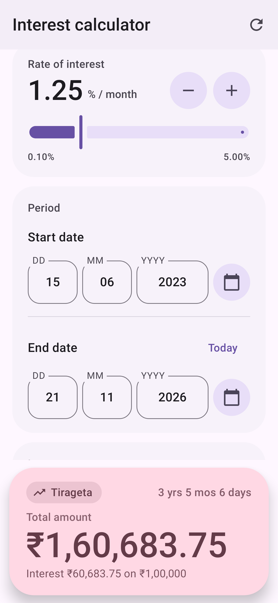
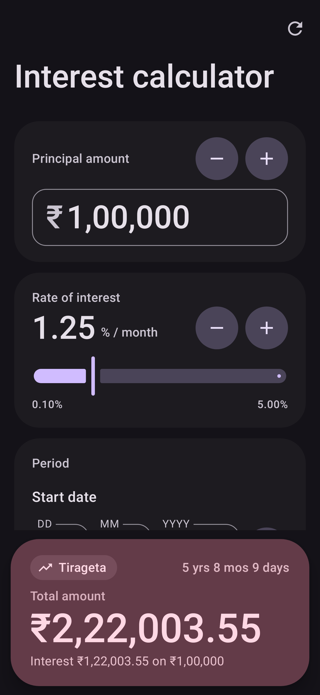
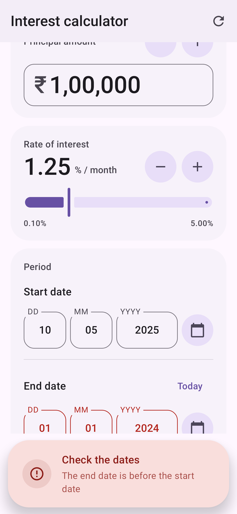
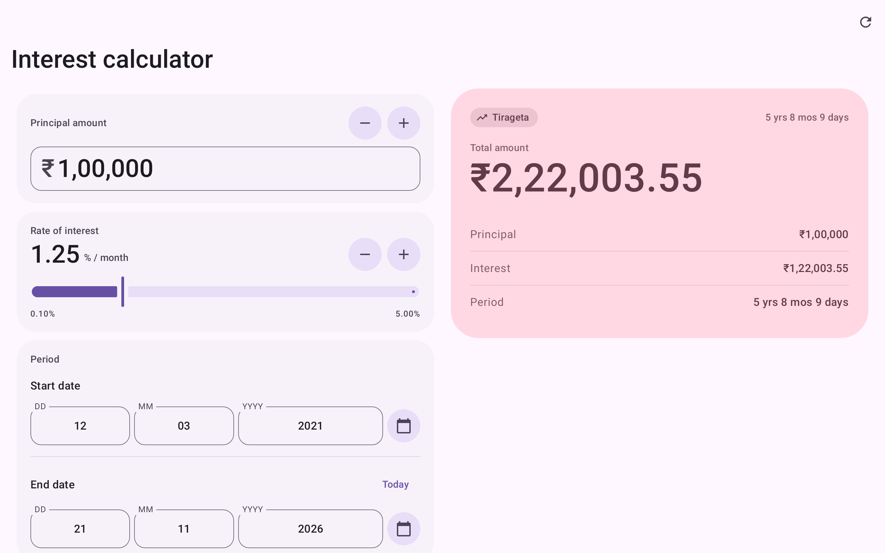

<div align="center">
  
  <h1>Interest Calculator</h1>
  <p><i>A fluid, offline Android app that computes "Tirageta" and "Plain" interest live as you type.</i></p>
</div>

<p align="center">
  
  
  
</p>
<p align="center"></p>

---

## 📥 Download

Get the latest APK from **[Releases](https://github.com/srivinodp/Interest_calculator/releases/latest)**
(Android 7.0+). The APK is signed with a development key, so if you later install a Play Store
build, uninstall this one first.

## ✨ What's new in 2.0

Version 2.0 is a full rebuild in Kotlin, Jetpack Compose and Material 3 Expressive. **The interest
calculation is the same as v1**: it is a line-for-line port, and a test runs it against the original
Java code over about 3.4 million inputs (see [Logic parity](#-logic-parity)).

**Motion**
* **Rolling digits:** the total, the amount and the rate roll like an odometer, up when the value grows and down when it shrinks. While you drag a slider the digits switch to instant updates, so the number tracks your finger with no lag.
* **Expressive springs** from `MotionScheme.expressive()` drive every transition, so motion feels physical and can be interrupted midway.
* **Shape-morphing buttons:** Tirageta / Plain is a connected button group whose corners morph on press, with a check mark that grows in.
* **Live result card** that changes color and content as it moves between hint, result and error states.
* **Shake and haptics** when the end date is before the start date, plus tick haptics while sliding.
* **Staggered entrance**, a collapsing large top app bar, and a splash-to-app zoom hand-off.

**Smoothness**
* Animations run in the draw/layout phase (`graphicsLayer`, `drawBehind`), so a frame doesn't recompose.
* The result is a `derivedStateOf`, so only the result card recomposes while you type or slide.
* Tabular figures (`tnum`) keep the layout still while numbers change.
* `Modifier.preferredFrameRate(High)` requests the panel's top refresh rate (e.g. 120 Hz) only while something animates.
* R8 full optimization + resource shrinking, plus a **Baseline Profile** installed via `profileinstaller`.

**Fluid display**
* Edge-to-edge, with the result dock riding on top of the keyboard frame-synced to the IME animation.
* **Adaptive layout:** a floating result dock on phones, and inputs beside a large result card on tablets, foldables and landscape.
* Material You dynamic color, dark theme, predictive back.
* **New app icon:** a "%" whose slash is a rising growth arrow, as an adaptive icon with a
  themed (monochrome) layer for Android 13+ and a matching splash screen.
* Survives rotation, fold/unfold and process death.

**Input**
* Same DD / MM / YYYY boxes as v1, now auto-advancing like a PIN entry.
* Calendar picker and a **Today** shortcut for the end date.
* **Type the exact principal**: any whole amount up to ₹99,99,99,999 (v1's slider stopped at ₹10,00,000), with lakh/crore commas as you type. − / + change it by ₹1,000.
* The rate keeps its slider, with − / + for 0.01 % steps (tap = one step, hold = accelerating repeat).
* Indian number grouping (₹1,00,000) and a breakdown of principal, interest and period.

## 🧮 Logic parity

`InterestCalculator.kt` is a line-for-line port of v1's `calculateInterest()`. The operand order,
int/double mixing, the `float` rate and `Math.round` are all kept as they were. `InterestCalculatorParityTest`
runs it against **v1's original Java code** (`LegacyInterestLogic.java`) and compares the exact
output strings (e.g. `Tirageta  152087.5`) over:

* every calendar date pair across four years (1.38M cases),
* every rate from 0.10 to 5.00 at boundary amounts on long periods,
* 1M random typed amounts (any whole rupee up to 2^24, where v1's float amount is exact),
* 2M random inputs, including the odd ones v1 accepted (day `00`, month `13`, leading zeros, year `0000`),
* v1's validation order (missing dates → no mode → date order).

## 🚀 Getting started
1. Open the project in **Android Studio** (Narwhal 4 / 2026.1 or newer).
2. It needs **JDK 17+**. The Gradle wrapper (9.9.1) handles the rest.
3. Run on a device. **Judge smoothness on the `release` variant**: Compose is much faster once minified.
   The release build is signed with your local debug key so it installs directly. Swap in a real
   upload key before publishing.

```bash
./gradlew :app:installRelease      # install the optimized build on a connected device
./gradlew :app:testDebugUnitTest   # parity test + UI tests + screenshots (app/build/screenshots)
```

## 🛠 Tech stack
* **Language**: Kotlin 2.3
* **UI**: Jetpack Compose (BOM 2026.09), Material 3 Expressive 1.5
* **Build**: AGP 9.5 (built-in Kotlin), Gradle 9.9 with version catalog and configuration cache
* **Tests**: JUnit, Robolectric 4.18, Roborazzi screenshots, Compose UI test
* **Min SDK**: 24 (Android 7.0); **Target SDK**: 36; **Compile SDK**: 37

---
<div align="center">
  <sub>Built with ❤️ for rapid financial calculations</sub>
</div>
